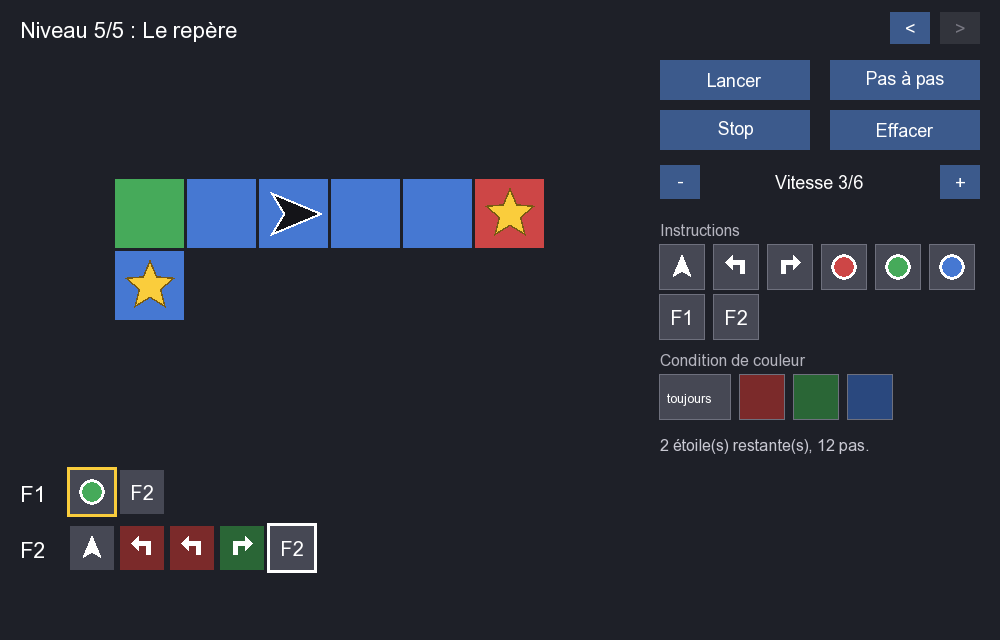

<div align="center">

# Jeux des cases

**A programming puzzle: write the instructions that guide an arrow to every star.**




</div>

The arrow moves on a grid of coloured tiles. You fill its functions F1, F2… with instructions, press Play, and it must pick up every star without falling off the grid.

- Move forward, turn left, turn right, paint the tile, call a function
- Any instruction can be limited to one tile colour
- The arrow always starts with F1; calling a function from itself makes a loop
- Step-by-step mode and adjustable speed
- Levels are plain text files in `niveaux/`

| | |
|---|---|
| `src/Niveau` | level file reader |
| `src/Automate` | game rules: instruction queue, moves, stars |
| `src/Jeu` | SFML window, editor and controls |
| `tests/verifier.cpp` | checks that every level loads and has a solution |

### Level format

```
nom Aller-retour
taille 7 1          # width height
depart 3 0 E        # x y direction (N, E, S, O)
fonctions 4         # size of F1, F2, ...
grille
rBBBBBr             # R red, V green, B blue, . hole, lowercase = star
```

### Build

Needs SFML 2.x (not 3).

```bash
brew install sfml@2
cmake -B build -DSFML_ROOT="$(brew --prefix sfml@2)"
cmake --build build
ctest --test-dir build
./build/JeuxDesCases
```

Space plays or pauses, Enter runs one step, Escape stops, Page Up/Down change level. Right-click a slot to empty it.

---

La flèche se déplace sur un quadrillage de cases colorées. On remplit ses fonctions F1, F2… avec des instructions, on lance, et elle doit ramasser toutes les étoiles sans sortir du quadrillage.

- Avancer, tourner à gauche, tourner à droite, peindre la case, appeler une fonction
- Chaque instruction peut ne s'exécuter que sur une couleur de case
- La flèche commence toujours par F1 ; une fonction qui s'appelle elle-même fait une boucle
- Mode pas à pas et vitesse réglable
- Les niveaux sont des fichiers texte dans `niveaux/`

| | |
|---|---|
| `src/Niveau` | lecture des fichiers de niveau |
| `src/Automate` | règles du jeu : file d'instructions, déplacements, étoiles |
| `src/Jeu` | fenêtre SFML, éditeur et commandes |
| `tests/verifier.cpp` | vérifie que chaque niveau se charge et a une solution |

### Format des niveaux

```
nom Aller-retour
taille 7 1          # largeur hauteur
depart 3 0 E        # x y direction (N, E, S, O)
fonctions 4         # taille de F1, F2, ...
grille
rBBBBBr             # R rouge, V vert, B bleu, . trou, minuscule = étoile
```

### Compiler

Nécessite SFML 2.x (pas la 3).

```bash
brew install sfml@2
cmake -B build -DSFML_ROOT="$(brew --prefix sfml@2)"
cmake --build build
ctest --test-dir build
./build/JeuxDesCases
```

Espace lance ou met en pause, Entrée exécute un pas, Échap arrête, Page précédente/suivante change de niveau. Clic droit sur une case du programme pour la vider.
